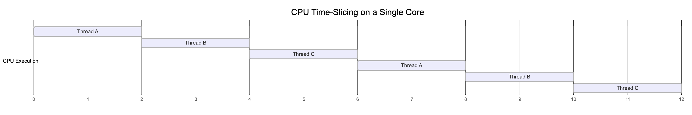
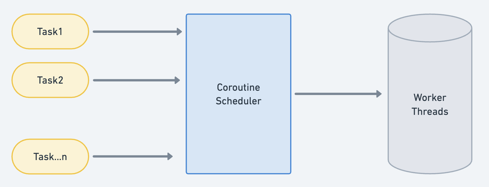
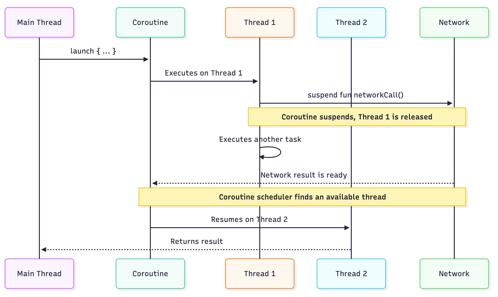

Mobile apps today have evolved from simple, single-purpose tools to sophisticated platforms that are integral to the daily lives of users. This means apps are expected to perform tasks asynchronously—whether it’s calling an API, performing real-time data exchange, downloading a file, or even running LLM models locally.

While asynchronous execution is often done by threads in Android world, over time they have been wrapped with different library implementations such as RxJava's `Schedulers`, Kotlin Coroutine's `Dispatcher`, good old `ExecutorService` and even the abhorrent `AsyncTask`.

While writing code, we often use these mechanisms liberally and assume "parallel" execution happens in the background. However, that's rarely the case. True parallelism is often an illusion, as there is usually a sequential execution bottleneck somewhere downstream.

## Precursor - Concurrency and Parallelism
All tasks must be completed with help of CPU and RAM, with former helping with computation and latter with memory.
CPU has limited resources, defined by it's frequency. A 2GHZ CPU runs 2 billion cycles in a second, every cycle or bunch of cycles can execute an instruction, which could as small as addition of integers or as complex as computing square root.
Tasks in the CPU often go into a waiting state, as they might be dependent on RAM for memory access or the network for I/O. This is a waste of time for the CPU, as it can't do much while it waits.

This is where **time-slicing**, a foundational concept for threads, comes in. 
Time-slicing divides the CPU's time into small slices, which are allocated to each thread. A thread executes some work during its time slice and then pauses until its next turn. This rapid switching is helpful in avoiding CPU wait states and achieving maximum efficiency.



Threads, by design, are concurrent. Each thread is given a slice of the same linear time, and at the application layer, it appears that things are happening in parallel. (Don't worry, we'll follow through with some examples on this).

Modern devices come with multiple cores, which means now you have multiple CPUs and their cycles running actually in parallel. There is slicing or waiting when multiple cores run together, each of them can pick instruction at same linear time in their own space. Hence true parallelism comes with multi-core.

## Computation tasks

Let's start by looking at a simple task
```kotlin
private fun task(number: Int): Long {
    val start = System.currentTimeMillis()
    var result = 0.0
    for (i in 0..99999) {
        result += sqrt(Math.random() * i + 1)
        result += sin(result)
        result += ln(abs(result) + 1)
    }
    val end = System.currentTimeMillis()
    return end - start 
}
```

This is an example of computational tasks, which would need a chunk of CPU and RAM to execute. If executed on main thread, it would take couple of seconds on lower end device. So let's move it to to thread.

```kotlin
thread {
  task(1)
}
```
which outputs to
```
Task 0 took 413 ms
```
Great we saved ~400ms of main thread's time, which can be used for UI.

Now let's see if we are to run more of these tasks, what happens. I'll modify the code to following

```kotlin
val executor: ExecutorService = Executors.newCachedThreadPool()
val scope = CoroutineScope(executor.asCoroutineDispatcher())
lifecycleScope.launch {
    val start = System.currentTimeMillis()
    val tasks = List(8) { index ->
        scope.async { task(index) }
    }
    val result = tasks.awaitAll()
    val end = System.currentTimeMillis()
    println("total time: ${end - start}ms")
}
```
To control environment, I have used my own dispatcher powered by an executor service. If I run the tasks 8 times and wait for results, here is what i get.

```kotlin
total time: 1815 ms
```
While original task took ~400ms, if dispatched parallely via `async` it took ~1800ms, still better than if we had to the same sequentially (8 * 400ms = 3200ms) but still far cry from being parallel.
Let's dig a bit deeper, we can figure out which thread each task ran on using
```kotlin
Thread.currentThread().name
```
which results into
```kotlin
total time: 1801 ms on threads: [pool-2-thread-1, pool-2-thread-2, pool-2-thread-3, pool-2-thread-4, pool-2-thread-5, pool-2-thread-6, pool-2-thread-7, pool-2-thread-8]
```
Great I can see 8 threads were spawned. Another question which arises is that my phone has multiple processors so it should be able to handle parallelism more efficiently. Let's figure out how many processor I have
```kotlin
Runtime.getRuntime().availableProcessors()
```
which results into
```kotlin
8
```
I still need to figure out if all processors were used and which thread used which processor. While there are no kotlin/java APIs for it, we can still get this information from JNI.
```C
extern "C" JNIEXPORT jint JNICALL
Java_com_example_myapplication_CoreChecker_getCurrentCPUCore(JNIEnv *env, jobject thiz) {
    return sched_getcpu();
}
```
```kotlin
class CoreChecker {
    external fun getCurrentCPUCore(): Int
}
```
Now I'll plug this method in my `task` method and run it again and voila
```kotlin
total time: 1884 ms on cores: [6, 7, 5] and threads: [pool-2-thread-1, pool-2-thread-2, pool-2-thread-3, pool-2-thread-4, pool-2-thread-5, pool-2-thread-6, pool-2-thread-7, pool-2-thread-8]
```
So our 8 computationally heavy tasks, ran on 8 threads spread across 3 processors. The questions arises, why not use 8 processors. Before we answer that, let's see if we can force our tasks to use separate CPUs.

Again, with help of JNI, we can pin threads to a specific core.
```C
extern "C" JNIEXPORT jboolean JNICALL
Java_com_example_myapplication_CoreChecker_pinCurrentThreadToCore(JNIEnv *env, jobject thiz,
                                                                  jint coreId) {
    cpu_set_t cpuset;
    CPU_ZERO(&cpuset);
    CPU_SET(coreId, &cpuset);
    int result = sched_setaffinity(0, sizeof(cpu_set_t), &cpuset);
    return result == 0;
}
```
```kotlin
external fun pinCurrentThreadToCore(coreId: Int): Boolean
```

After adding this to our task, let's see the output again
```kotlin
total time: 2614 ms on cores: [0, 1, 2, 3, 4, 5, 6, 7] and threads: [pool-2-thread-1, pool-2-thread-2, pool-2-thread-3, pool-2-thread-4, pool-2-thread-5, pool-2-thread-6, pool-2-thread-7, pool-2-thread-8]
```

Well, lol we ended up taking longer by using more hardware, perhaps best to let system schedule tasks for us!

Let's recap
- Our task took ~400ms when ran alone.
- If we ran 8 tasks in parallel via `async`, it took ~1800ms.
- We were able to confirm that tasks run on multiple threaded, multiple core environment.
- If we decide to use all cores, it actually slowed down overall execution.

What happened
- Since our tasks, are computationally intensive we consistently use the CPU's resources along with RAM access.
- Threads will parallise our tasks at application layer, but all of them keep hogging time slices provided to them by CPU.
- Even with multi cores, RAM still remains one of the choke point since all computation results have to be stored in memory stack.

### CPU Scheduling
The curious case of our tasks slowing down when we tried to use all CPU cores is because Android OS has a dynamic CPU scheduler, and all cores are not equal in nature. Most devices use ARM's [big.little](https://www.arm.com/technologies/big-little) architecture, for ex my own test device `Pixel 4a` has 2 cores with `2.2ghz` frequency and another 6 with `1.8ghz` frequency. While smaller cores remain more active, larger cores are woken up only when needed to preserve battery. Scheduling cores adds it own delays, since cores need to be woken up (which affects battery as well) so custom scheduling in most cases will be slower. In an event, your phone already has 8 cores active, these task execution would be much faster, so it's always better, unless building a game, to let OS schedule your tasks for you.

## I/O tasks
I/O tasks are where threads usually shine with their capabilities. I/O can be divided into disk or network I/O, Disk I/O largely becomes computational in nature on apps since unlike backend where application and databases may have different servers and hardware, on apps database is part of same hardware where app is running.

Let's try out our previous steps with Network I/O.
To keep results stable of network fluctuations, I'll run a local server which returns response in 2 seconds.

```kotlin
private val okHttpClient = OkHttpClient.Builder().apply 
    connectionSpecs(listOf(ConnectionSpec.CLEARTEXT))
}.build()
private val url = "http://localhost:3000/serve.json"
private val request = Request.Builder().url(url).build()

private fun ioTask(number: Int): Triple<Long, Int, String> {
    val start = System.currentTimeMillis()
    okHttpClient.newCall(request).execute()
    val end = System.currentTimeMillis()
    return Triple(
        end - start,
        coreChecker.getCurrentCPUCore(),
        Thread.currentThread().name
    )
}
```

Let's run this task in similar setup

```kotlin
val scope = CoroutineScope(executor.asCoroutineDispatcher())
lifecycleScope.launch {
    val start = System.currentTimeMillis()
    val tasks = List(1) { index ->
        scope.async { ioTask(index) }
    }
    val result = tasks.awaitAll()
    val end = System.currentTimeMillis()
    val cores = result.map { it.second }.distinct()
    val threads = result.map { it.third }.distinct()
    println("total time: ${end - start} ms on cores: $cores and threads: $threads")
}
```

Let's run one task
```kotlin
io Task took 2141 ms on Thread: pool-2-thread-1 core: 6
```
Great, server has a 2 second delay, which means we are mostly getting response in ~2 seconds.

Let's run 8 io tasks
```kotlin
total time: 2344 ms on cores: [7, 6] and threads: [pool-2-thread-1, pool-2-thread-2, pool-2-thread-3, pool-2-thread-4, pool-2-thread-5, pool-2-thread-6, pool-2-thread-7, pool-2-thread-8]
```
Here we can see our calls are happening nearly in parallel, unlike computation tasks since threads are able to use slices of CPU time more efficiently. One might argue, we might achieve similar results even in a single core setup. Let's try that, we'll pin our all of our I/O tasks to a single core.
```kotlin
coreChecker.setCore(0)
```
which results into 
```kotlin
total time: 2411 ms on cores: [0] and threads: [pool-2-thread-1, pool-2-thread-2, pool-2-thread-3, pool-2-thread-4, pool-2-thread-5, pool-2-thread-6, pool-2-thread-7, pool-2-thread-8]
```
A marginal increase, but perhaps still can be considered a good amount of parallelisation.

Let's try forcing each network call on a core, which results in
```kotlin
total time: 2266 ms on cores: [0, 1, 2, 3, 4, 5, 6, 7] and threads: [pool-2-thread-1, pool-2-thread-2, pool-2-thread-3, pool-2-thread-4, pool-2-thread-5, pool-2-thread-6, pool-2-thread-7, pool-2-thread-8]
```
As we can see our total time taken is mostly same within range ~200ms up or down.

Let's recap
- Our single io task took ~2s when ran alone.
- If we ran 8 by parallizing via `async`, it still took ~2s.
- Even if we ran 8 tasks on single core the time was still ~2s.
- If we decide to use all cores, the improvement difference was marginal.

What happened
- Since our tasks are I/O bound, large amount of processing happens outside of device, hence we don't need much resources from CPU/RAM in a continous loop.
- Threads parallised our tasks at application layer and they are able to use slices of CPU time more efficiently, since they have spend most of their own time waiting.

## Coroutines and Concurrency
In world of Kotlin, this discussion would be incomplete without discussing coroutines. While we may all remember demos of running millions of coroutines or discussions of how coroutines are faster, it all depends on lower level implementation whether any performance benefits would be achieved.

Coroutines, are largely important to consider when using I/O as they run a layer above threads but would not provide much benefits(compared to threads) when computation tasks are running.

Let's look back to our I/O example.
```kotlin
okHttpClient.newCall(request).execute()
```
If we run this 64 times, via `async` we get following output
```kotlin
total time: 2309 ms on cores: [6, 7, 0] and threads: [pool-2-thread-1, pool-2-thread-2, ..... pool-2-thread-64]
```
While we are trying to execute using coroutines, it still spawned 64 threads. The reason here is that underlying network call in okhttp is a blocking function, which ends up blocking whichever thread it runs until response is received. Hence each call will still spawn a new thread and we do not get any runtime advantage of coroutines.

Another way to execute network call would be via `enqueue` which is non blocking in nature.
```kotlin
okHttpClient.newCall(request).enqueue(object : Callback {
    override fun onFailure(call: Call, e: okio.IOException) {}
    override fun onResponse(call: Call, response: Response) {}
})
```
But when `enqueue` is used, `okhttp` internally uses an `ExecutorService` to submit new calls which will still end up spawning as many threads as number of network calls.

#### Using Ktor
Ktor provides a coroutine native way to execute I/O calls using suspend functions. Let's try that
```kotlin
// CIO is Ktor's async execution engine
private val ktorClient = HttpClient(CIO)

// api call
ktorClient.get(url).bodyAsText()
```

Since CIO doesn't allow configuration of `Dispatcher`, we will have to live with what it uses internally which `Dispatchers.IO`. I'll also setup a thread monitor to understand how many threads were spawned internally.

```kotlin
Timer().schedule(object : TimerTask() {
    override fun run() {
        val threads = Thread.getAllStackTraces().keys
            .filter {
                it.name.contains("DefaultDispatcher") ||
                        it.name.contains("ktor") ||
            }
        println("total threads: ${threads.distinct().size}")
        threads.forEach {
            println("I/O Thread: ${it.name}")
        }
    }
}, 0, 5000)
```

```kotlin
total time: 2951 ms on cores: [6, 7, 3, 2, 5]
total threads: 53
```
We can see number of threads are lower, but not by much. Let's try to understand this.

### Understanding Coroutine Scheduling
Dispatchers provided by coroutine library use [CoroutineScheduler](https://github.com/Kotlin/kotlinx.coroutines/blob/master/kotlinx-coroutines-core/jvm/src/scheduling/CoroutineScheduler.kt) internally to schedule tasks over threads. Think of this an orchestration layer where it accepts a bunch of tasks and then decides if they can run on an existing thread or a spawn a new one.



This is quite fascinating as it implements quite a bit of cleverness which help of suspend functions and even stealing of work to push on idle threads(might I suggest using your fav LLM to explain this to you).

Essentially coroutines will spawn a thread if it finds a thread is not free. A suspending function, will mark thread as free for ex in case of network calls but not in case it is doing any computation since it becomes blocking.


In a non coroutine environment, thread remains blocked when request is made until response is recieved, but with coroutine as we "suspend" the function, underlying thread becomes free while we are waiting on network making it a bit more efficient.

The caveat here is, if you try to execute tasks simultaneously, it will spawn threads eagerly since worker still remains blocked for sending the request for couple of milliseconds(or hundreds based on device) which then triggers new thread creation.

This is also verifiable, if I add a small delay ~10ms before launching I/O, number of threads used go down as underlying pool is used more efficiently.

```kotlin
val tasks = List(64) { index ->
    ++
    delay(10)
    ++
    async { ioTask(index) }
}
```

```kotlin
total time: 3055 ms on cores: [7, 2, 4, 0, 6]
total threads: 27
```
While overall execution time has slight bump, number of threads have reduced by half with staggered execution of tasks.

Overall this seems quite efficient for server side applications where hundreds or thousands of request are considered normal behaviour, but not for mobile applications where such count would be anti-pattern.

#### Can coroutines run concurrently?

Yes, definitely. A simple way to validate is running bunch of non blocking coroutines isolated to single thread.
```kotlin
val scope = CoroutineScope(Executors.newSingleThreadExecutor().asCoroutineDispatcher())
lifecycleScope.launch {
    val start = System.currentTimeMillis()
    val tasks = List(64) { index ->
        scope.async { delay(2000) }
    }
    val result = tasks.awaitAll()
    val end = System.currentTimeMillis()
}
```
which results
```kotlin
total time: 2110 ms on threads: [pool-2-thread-1]
```
while `delay` is very crude example, but it allows us validate concurrency within coroutines. Real life usages varies a lot and is entirely dependent on scheduling capabilities of `CoroutineScheduler` along with underlying physical hardware.

## Conclusion
In terms of mobile app development, we should remain considerate of these internal workings to accurately approximate how much such assumed "parallel" tasks affect memory and performance.

A network call can be I/O but serialisation is still CPU/RAM blocking in nature which is attached to almost every network call. Too many reads of preferences, sqlite behind fancy launches of `Dispatchers.IO` will still affect UI performance as there is real cost to context switching between threads happening too often.

We should also never assume just moving to coroutines will provide us better performance, as underlying layers of libraries such might still be dealing with threads. **Coroutines do provide excellent use case of orchestrating work using structured concurrency and much better APIs so they are useful but should be considered in same nature.**

If you ever want to check out such patterns for your app, run a [perfetto](https://perfetto.dev/) trace on your flow and use following query to get count of threads

```sql
SELECT 
  CASE 
    WHEN t.name LIKE '%OkHttp%' THEN 'OkHttp'
    WHEN t.name LIKE '%pool%' THEN 'ThreadPool'
    WHEN name LIKE '%DefaultDispatch%' THEN 'Coroutines-Dispatcher'
    WHEN t.name = 'main' THEN 'Main'
    // add more cases as needed
    ELSE 'Other'
  END as category,
  COUNT(*) as thread_count,
  GROUP_CONCAT(t.name) as thread_names
FROM thread t
JOIN process p ON t.upid = p.upid
WHERE p.pid = //your process id
GROUP BY category
ORDER BY thread_count DESC;
```